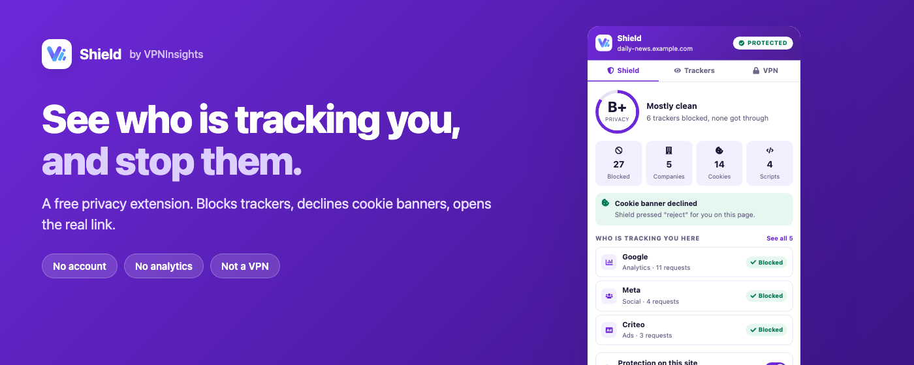
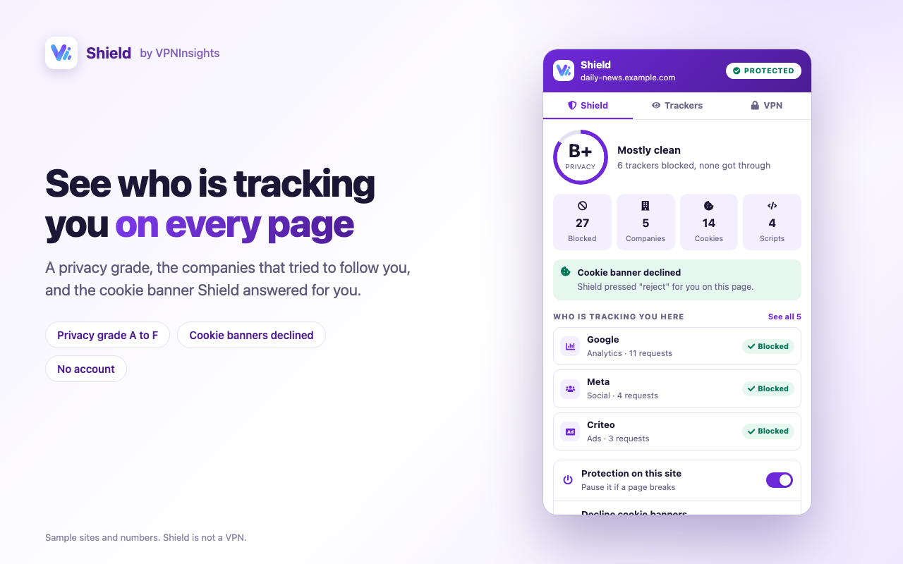
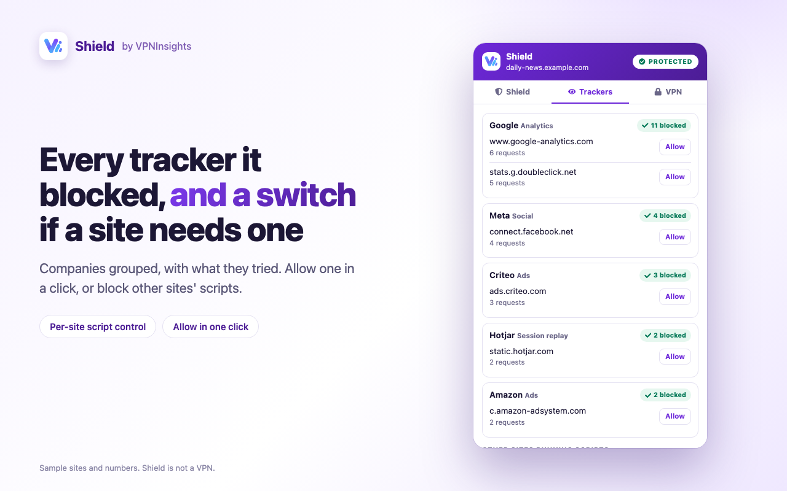
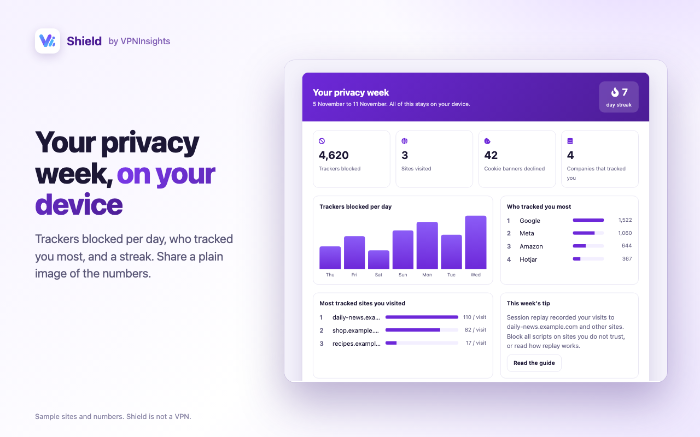

# Shield by VPNInsights



**A free, open-source privacy extension. Blocks trackers, rejects cookie banners, cleans tracking links and shows you who tried to follow you on each page. No account. No analytics. Not a VPN.**

Made by [VPNInsights](https://vpninsights.com). MIT licence.

Website: [vpninsights.com/shield](https://vpninsights.com/shield) · Privacy policy: [vpninsights.com/shield/privacy](https://vpninsights.com/shield/privacy)

## Install

| Browser | Status |
|---|---|
| Chrome, Brave, Vivaldi | [Install from the Chrome Web Store](https://chromewebstore.google.com/detail/shield-by-vpninsights-tra/hoffdjbbgjafckjomngkejkpkohdoknh) |
| Microsoft Edge | [Install from Microsoft Edge Add-ons](https://microsoftedge.microsoft.com/addons/detail/kdggfpbdchknbdkbigmehnfkmljmimpm) |
| Firefox | [Install from Mozilla Add-ons](https://addons.mozilla.org/en-US/firefox/addon/shield-by-vpninsights/) |
| Opera | In review on Opera add-ons. Until then, install the Chrome Web Store version. |

You can also load it yourself, see [Try it from source](#try-it-from-source).

## What it does

- **Blocks trackers and session recorders** from a bundled list of 168 services (`data/lists.json`), using the browser's own blocking rules (declarativeNetRequest).
- **Rejects cookie banners.** It presses "reject all" or "necessary only" on common consent pop-ups and never presses accept.
- **Opens the real link.** It skips redirect links (Google, Facebook, YouTube and others), removes tracking parts such as `utm_` and `fbclid`, and opens AMP pages as the real page.
- **Privacy grade (A to F) for every page**, with a plain list of the companies that tried to track you.
- **Fingerprint shield** (on in Strict mode): changes what a page can read from canvas, audio and hardware.
- **Global Privacy Control** signal sent on every page.
- **Weekly privacy report**, worked out on your device.
- **Data-breach warning** when the site you are on is in the public Have I Been Pwned breach list (checked on your device).
- **Optional breached-password warning** (off by default): only the first 5 characters of a password hash leave the page, to Have I Been Pwned.
- **VPN tab** that shows your address and whether it matches your VPN. Shield is not a VPN and does not hide your IP address.
- Per-site script control, your own blocking rules, imported lists, and one-tap clearing of a single site's data.

The full feature list is in [docs/FEATURES.md](docs/FEATURES.md).

## Screenshots





Screenshots use sample sites and sample numbers.

## Privacy

- No account. No analytics. No ads. No affiliate links.
- Settings and weekly numbers stay in your browser (`storage.local`).
- The only network requests are ones you ask for: the VPN tab (`vpninsights.com/api/tools/ip`), the optional password check, and any list address you import.
- No remote code. Every list and script is inside the extension.

Details: [PRIVACY.md](PRIVACY.md).

## Why it asks for "read and change all sites"

Browsers show this warning for every blocker. Shield uses it to block trackers before they load, clean links, send the GPC signal, decline cookie banners and control scripts. It does not read what you type, apart from the optional password check, which keeps only a hash on the page.

| Permission | Why |
|---|---|
| `declarativeNetRequest` | Block tracker requests, remove tracking parameters, redirect AMP pages, apply your rules |
| `webRequest` | Count blocked requests per tab so the popup can show them. Does not read or change request contents |
| `scripting` | Register the page scripts (cookie banners, links, fingerprint shield, password check, GPC flag) |
| `storage` | Keep settings, per-site choices and weekly numbers on the device |
| `cookies`, `browsingData` | Clear one site's data when you press the button, or when the optional cleanup is on |
| `privacy` | Stop sites reading your local network address through WebRTC |
| `tabs` | Know which site the current tab shows |
| `alarms`, `notifications` | The Monday report and the optional "your IP address changed" warning |

## Try it from source

1. Chrome, Edge, Brave: open `chrome://extensions`, turn on **Developer mode**, press **Load unpacked**, choose this folder.
2. Firefox: `npm install` is not needed for this. Run `node tools/package.mjs`, unzip `dist/*-firefox.zip`, then open `about:debugging`, **This Firefox**, **Load Temporary Add-on**, and choose its `manifest.json`.

## Develop

```bash
npm install                  # only needed for build:icons
node tools/build-rules.mjs   # rebuild rules/ and src/categories.js after editing data/lists.json
node tools/build-breaches.mjs# refresh the breach list from Have I Been Pwned (monthly)
node tools/build-icons.mjs   # rebuild popup/icons.js (Font Awesome Free icons as inline SVG)
node tools/test-unit.mjs     # rules, settings logic, manifest and file checks
node tools/test-chrome.mjs   # loads it into a real headless Chrome and checks blocking, GPC, link cleaning
node tools/errors-chrome.mjs # uses it on real sites and fails on any extension error
node tools/package.mjs       # builds the Chrome and Firefox zips into dist/
```

Generated files (do not edit by hand): `src/categories.js`, `src/breaches.js`, `popup/icons.js`, `rules/*.json`.

## Project layout

```
manifest.json        Manifest V3
src/                 background service worker and content scripts
popup/ options/ report/ welcome/   the extension pages
rules/               declarativeNetRequest rulesets
data/                tracker list and company names (compiled by VPNInsights)
tools/               build and test scripts
```

## Contributing

Bug reports and site-breakage reports are welcome: open an issue with the address of the page and what stopped working. Please do not report that a page "has ads": Shield blocks trackers, not every ad. For a new tracker, send the domain and where you saw it.

## Licence and credits

MIT, see [LICENSE](LICENSE). Third-party items (Font Awesome Free icons, Have I Been Pwned breach names) are listed in [NOTICE.md](NOTICE.md).

Shield is made by [VPNInsights](https://vpninsights.com), which tests and reviews VPNs.
